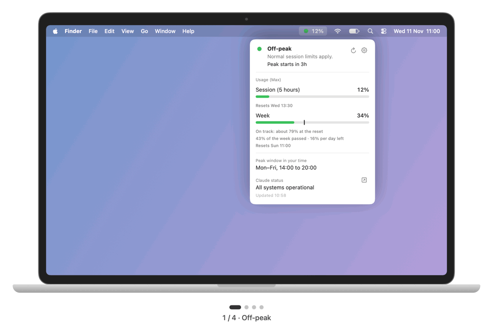
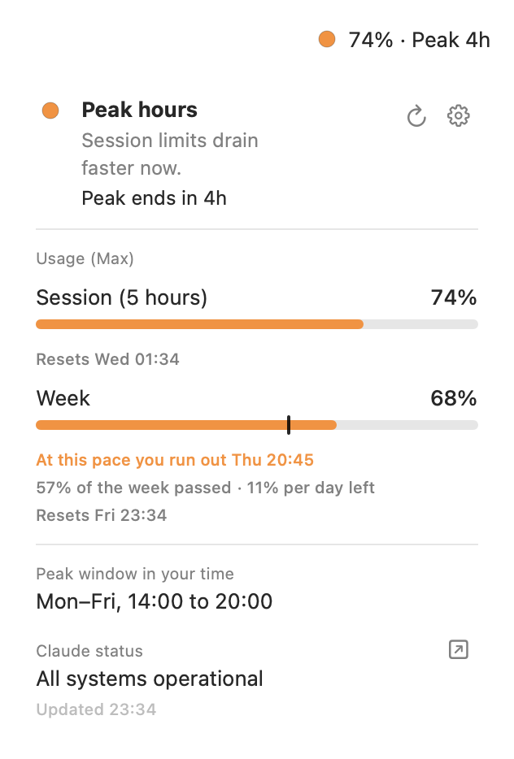
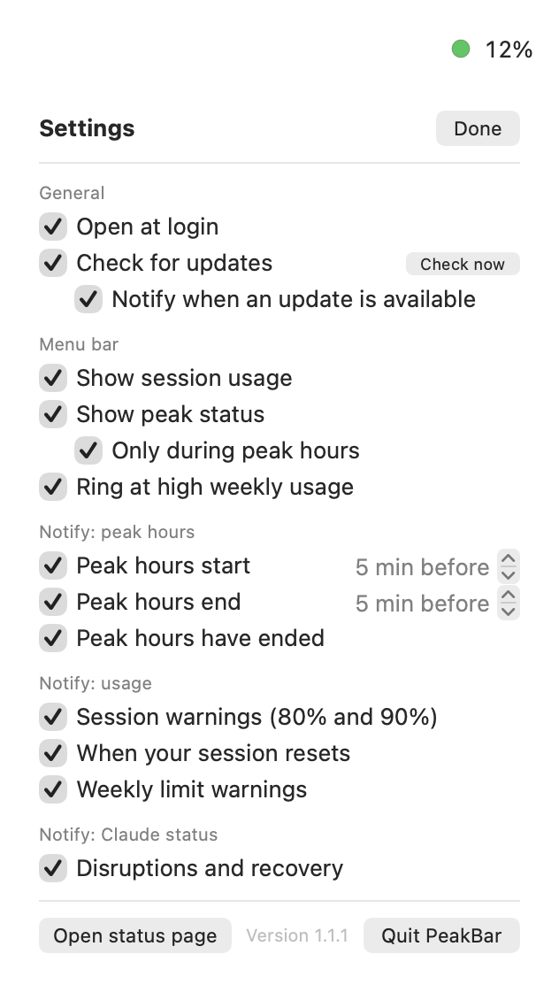

# PeakBar

A tiny macOS menu bar app that shows whether it is currently **Claude peak hours**, how much of your **session and weekly usage** you have used, and whether **status.claude.com** reports a disruption. It can notify you before peak hours start and end, when your session resets, and when you are running low.

<p align="center">
  
</p>

> Unofficial. Not affiliated with or endorsed by Anthropic.

## Features

**Menu bar**
- 🟢 off-peak, 🟠 peak hours, 🔴 Claude disruption
- Session percentage next to the dot, e.g. `42%`, and the peak countdown during peak hours: `42% · Peak 2h`
- An orange ring around the dot at 80% weekly usage, red at 90%

**Panel**
- Session (5 hours) and weekly usage with reset times
- Weekly pace: a marker shows how much of the week has passed, so you see at a glance whether you are ahead
- Forecast, e.g. "At this pace you run out Thu 20:31", and a daily budget to stay on track
- Peak window in your own time zone, daylight saving handled on both sides
- Live Claude status with open incidents
- The gear flips the card over to the settings; refresh is an icon next to it

**Notifications**
- Before peak hours start and before they end (minutes ahead are adjustable), and when they have ended
- Session warnings at 80% and 90%, and when your session resets
- Weekly warnings at 75% and 90%, and when your pace runs out before the reset
- Claude disruptions and their recovery

**Updates**
- Checks GitHub once a day for a new version, notifies you and shows an **Update** button on the card
- Downloads, verifies and installs the new version, then restarts. Powered by [Sparkle](https://sparkle-project.org)

English and Dutch, follows your macOS language. Native Swift, about 4 MB, Apple silicon and Intel, macOS 13 or later.

## Settings

<p align="center">
  <picture>
    <source media="(prefers-color-scheme: dark)" srcset="docs/panel-ahead-dark.png">
    
  </picture>
  &nbsp;&nbsp;
  <picture>
    <source media="(prefers-color-scheme: dark)" srcset="docs/panel-settings-dark.png">
    
  </picture>
</p>

All settings are on the back of the card (gear icon).

| Group | Setting | Default |
| --- | --- | --- |
| General | Open at login | off |
| | Check for updates (with a **Check now** button) | on |
| | Notify when an update is available | on |
| Menu bar | Show session usage | on |
| | Show peak status | on |
| | Only during peak hours | on |
| | Ring at high weekly usage (80% orange, 90% red) | on |
| Notify: peak hours | Before peak hours start (0 to 60 min, 0 = at the start) | on, 5 min |
| | Before peak hours end (1 to 60 min) | on, 5 min |
| | When peak hours have ended | on |
| Notify: usage | Session warnings (80% and 90%) | on |
| | When your session resets | on |
| | Weekly limit warnings (75%, 90%, running out early) | on |
| Notify: Claude status | Disruptions and recovery | on |

Each warning is sent at most once per session or week. macOS asks once for permission to show notifications.

## Install

1. Download `PeakBar-x.y.z.dmg` from [Releases](../../releases) and drag **PeakBar** to **Applications**.
2. Open PeakBar. The app is not notarized, so macOS warns you. Click **Done**.
3. Open **System Settings → Privacy & Security** and click **Open Anyway**.
4. Allow notifications when macOS asks.
5. Optional: tick **Open at login** on the back of the card.

Don't see the dot? Menu bar managers such as Hidden Bar or Bartender may hide new icons. Hold **⌘** and drag the dot to a visible spot.

## Where the data comes from

| What | Source |
| --- | --- |
| Peak hours | Calculated locally from the published window: weekdays 05:00 to 11:00 Pacific time. There is no official API. |
| Service status | [status.claude.com](https://status.claude.com) public Statuspage API, every 5 minutes. |
| Updates | `appcast.xml` in this repository, once a day. The download is the DMG from the GitHub release. |
| Usage | `api.anthropic.com/api/oauth/usage`, an **undocumented** endpoint that Claude Code's `/usage` also uses. It may change or stop working at any time. |

### Usage and your credentials

Usage only works if [Claude Code](https://docs.claude.com/en/docs/claude-code) is installed and you are logged in with `claude`. PeakBar then:

- reads Claude Code's access token from the macOS Keychain, read only, through `/usr/bin/security`: the tool Claude Code itself uses to store it, so macOS does not ask for your password (also not after Claude Code renews its token),
- keeps it in memory only, never logs it or writes it to disk,
- sends it only over HTTPS to the endpoint in `config.json`, identifying itself as PeakBar,
- when the token has expired, runs `claude auth status` so **Claude Code renews its own token**. PeakBar never touches the refresh token.

Without Claude Code, peak hours and status still work.

## Build from source

Requires the Xcode Command Line Tools (`xcode-select --install`).

```bash
scripts/build.sh            # build/PeakBar.app
scripts/build.sh install    # also install to /Applications and start
scripts/package.sh          # build/PeakBar-<version>.dmg
scripts/preview.sh          # build/preview.png, renders the panel offscreen
scripts/preview.sh docs     # also writes the README images and demo.gif to docs/
```

All names and settings live in `config.json`: app name, bundle id, version, peak window, URLs, poll intervals and signing. Renaming the app is a change in that one file.

### Updates

Every release is signed with an EdDSA key; the app only installs updates that carry a valid signature, and the feed itself is signed too. The public key is in `config.json`, the private key stays in the maintainer's Keychain (create it with `build/vendor/Sparkle-*/bin/generate_keys --account <update.keyAccount>`). Sparkle is downloaded by `scripts/build.sh` at the version pinned in `config.json` and checked against its SHA-256.

Releasing a new version:

1. Set `version` in `config.json` and add a `## <version>` section to `CHANGELOG.md` (it becomes the release notes in the update dialog).
2. Run `scripts/package.sh`. It builds the DMG and writes a signed `appcast.xml`.
3. Publish the GitHub release `v<version>` with the DMG.
4. Commit and push `appcast.xml`. Only then do installed apps see the update.

To sign and notarize with a Developer ID, set `signing.identity` and `signing.notaryProfile` (a `notarytool` keychain profile) in `config.json`; `scripts/package.sh` then does the rest.

## Translations

Texts live in `Resources/<lang>.lproj/Localizable.strings`. English is the source; missing or empty keys fall back to English.

```bash
scripts/i18n.sh             # report missing keys per language
scripts/i18n.sh new de      # create an empty German file with all keys
scripts/i18n.sh fill nl     # add only missing keys (empty) to Dutch
```

## Changelog

See [CHANGELOG.md](CHANGELOG.md).

## License

[MIT](LICENSE)
