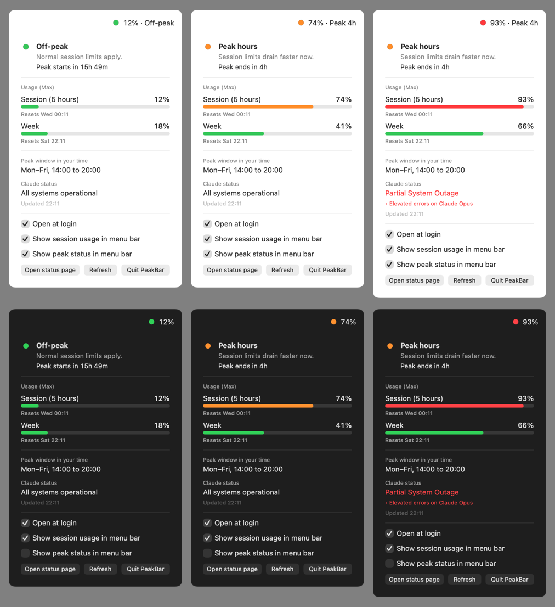

# PeakBar

A tiny macOS menu bar app that shows whether it is currently **Claude peak hours**, how much of your **session and weekly usage** you have used, and whether **status.claude.com** reports a disruption.



- 🟢 **Off-peak**, 🟠 **peak hours** (with time left), 🔴 **disruption**
- Session (5 hours) and weekly usage in percent, with reset times
- Peak window shown in your own time zone, daylight saving handled on both sides
- Menu bar text can be switched off (dot only)
- English and Dutch, follows your macOS language
- Native Swift, about 1 MB, Apple silicon and Intel, macOS 13 or later

> Unofficial. Not affiliated with or endorsed by Anthropic.

## Install

1. Download `PeakBar-x.y.z.dmg` from [Releases](../../releases) and drag **PeakBar** to **Applications**.
2. Open PeakBar. The app is not notarized, so macOS warns you. Click **Done**.
3. Open **System Settings → Privacy & Security** and click **Open Anyway**.
4. For usage percentages: allow Keychain access with **Always Allow** (see below).
5. Optional: tick **Open at login** in the panel.

Don't see the dot? Menu bar managers such as Hidden Bar or Bartender may hide new icons. Hold **⌘** and drag the dot to a visible spot.

## Where the data comes from

| What | Source |
| --- | --- |
| Peak hours | Calculated locally from the published window: weekdays 05:00 to 11:00 Pacific time. There is no official API. |
| Service status | [status.claude.com](https://status.claude.com) public Statuspage API, every 5 minutes. |
| Usage | `api.anthropic.com/api/oauth/usage`, an **undocumented** endpoint that Claude Code's `/usage` also uses. It may change or stop working at any time. |

### Usage and your credentials

Usage only works if [Claude Code](https://docs.claude.com/en/docs/claude-code) is installed and you are logged in with `claude`. PeakBar then:

- reads Claude Code's access token from the macOS Keychain (read only; macOS asks for permission),
- keeps it in memory only, never logs it or writes it to disk,
- sends it only over HTTPS to the endpoint in `config.json`, identifying itself as PeakBar,
- when the token has expired, runs `claude auth status` so **Claude Code renews its own token**. PeakBar never touches the refresh token.

Without Claude Code, peak hours and status still work.

## Build from source

Requires the Xcode Command Line Tools (`xcode-select --install`).

```bash
scripts/build.sh            # build/PeakBar.app
scripts/build.sh install    # also install to /Applications and start
scripts/package.sh          # build/PeakBar-<version>.dmg
scripts/preview.sh          # build/preview.png, renders the panel offscreen
```

All names and settings live in `config.json`: app name, bundle id, version, peak window, URLs, poll intervals and signing. Renaming the app is a change in that one file.

To sign and notarize with a Developer ID, set `signing.identity` and `signing.notaryProfile` (a `notarytool` keychain profile) in `config.json`; `scripts/package.sh` then does the rest.

## Translations

Texts live in `Resources/<lang>.lproj/Localizable.strings`. English is the source; missing or empty keys fall back to English.

```bash
scripts/i18n.sh             # report missing keys per language
scripts/i18n.sh new de      # create an empty German file with all keys
scripts/i18n.sh fill nl     # add only missing keys (empty) to Dutch
```

## License

[MIT](LICENSE)
